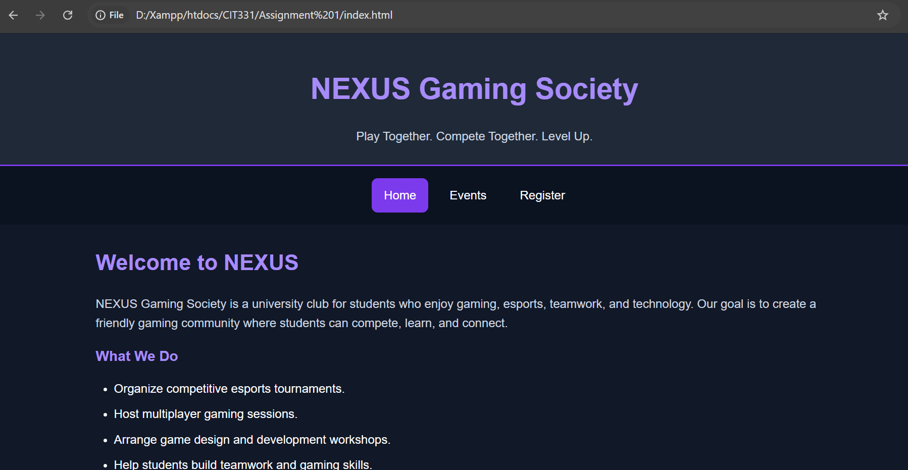

# NEXUS Gaming Society

## Project Overview
NEXUS Gaming Society is a student society website.It provides information about the society, upcoming gaming events, and an event registration form.

## Pages
- `index.html` — Home page
- `events.html` — Upcoming events
- `register.html` — Registration form

## Technologies Used
- HTML5
- CSS3
- JavaScript
- Browser localStorage
- Git and GitHub

## Features
- Navigation between three pages
- Responsive layout
- Event registration form with validation
- Saves registrations in browser localStorage
- Displays saved registrations and provides a Clear All option

## How to Run
Open `index.html` in a web browser, or use the VS Code Live Server extension.

## Author
Noraze khan

## Homepage Screenshot

